# Tagwise

A shared register for an organisation's assets and stock. Put a QR label on
each thing, scan it with any phone, import the spreadsheet you already have,
count a site with several people at once, and see every site on a map. Built
for schools, clinics, offices and stores that keep their register in Excel
today.

**Status: prototype.** It runs entirely in the browser with a fictional
sample organisation. There is no server, no sign-in and no real data yet.
What is real and what is not is listed below and in
[docs/WORK_ORDERS.md](docs/WORK_ORDERS.md).

| Light | Dark |
| --- | --- |
| 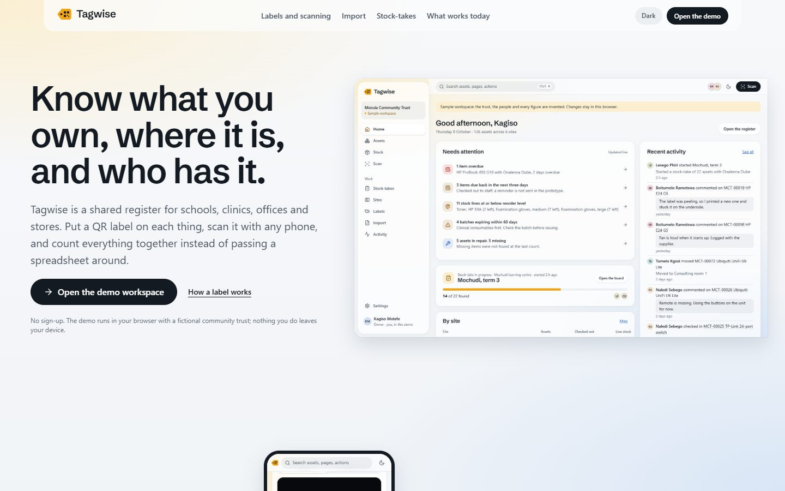 | 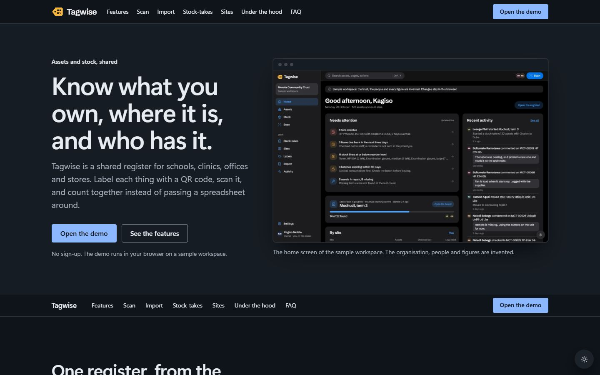 |
| 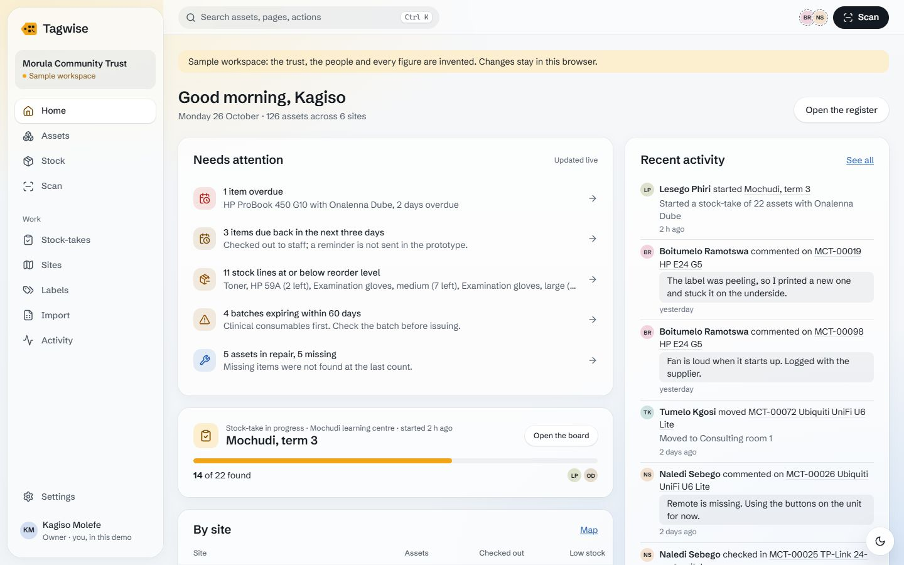 | 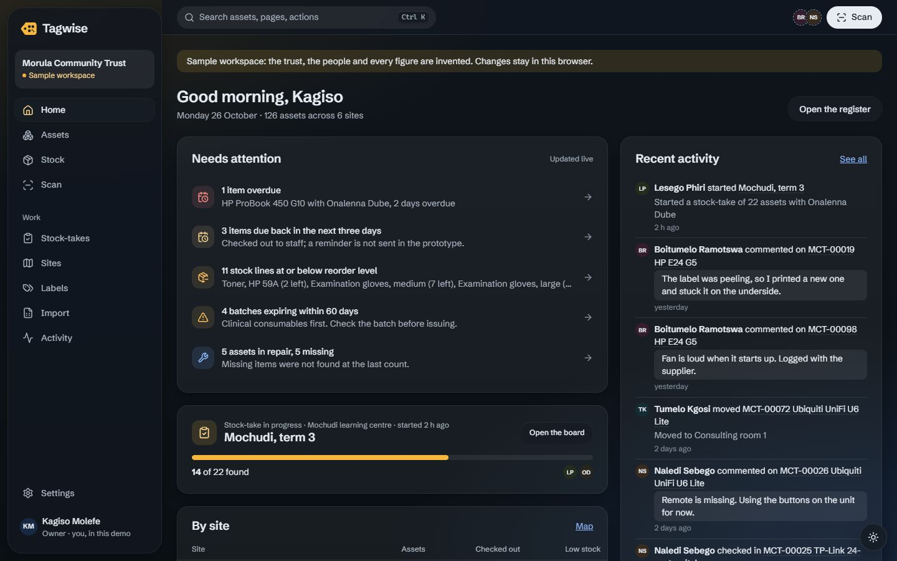 |
| 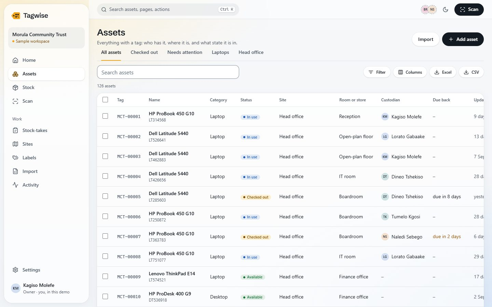 | 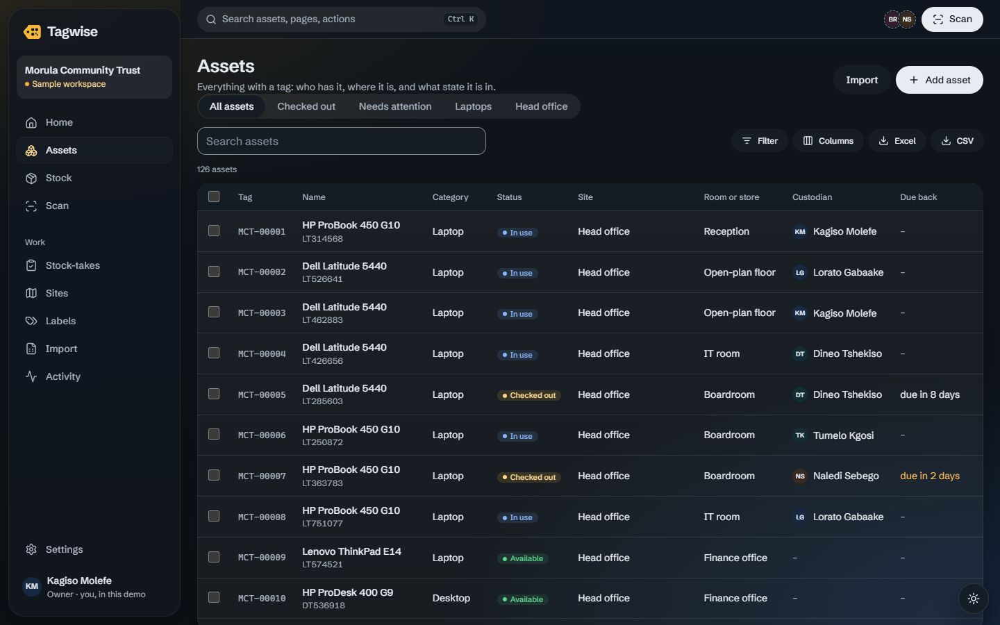 |
| 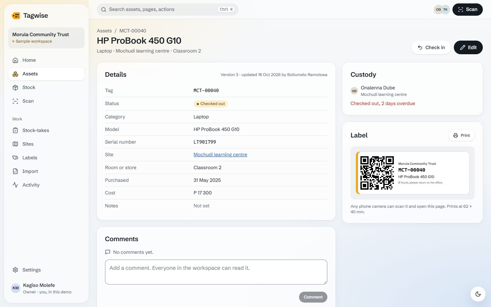 | 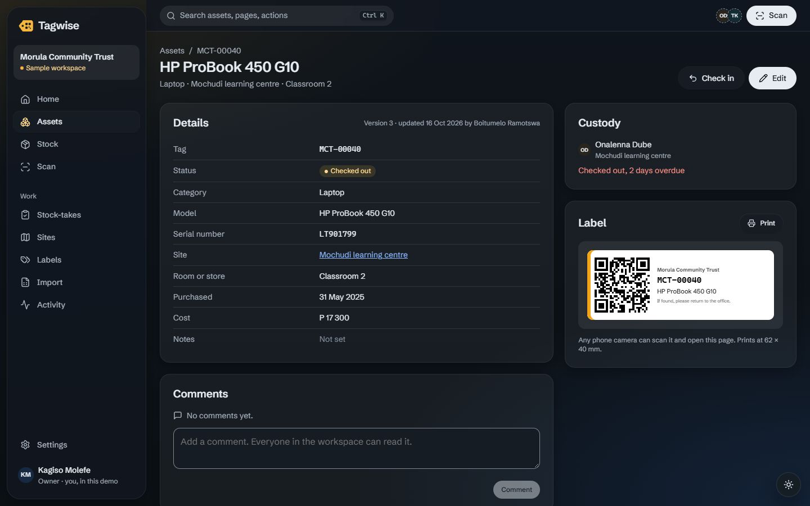 |
| 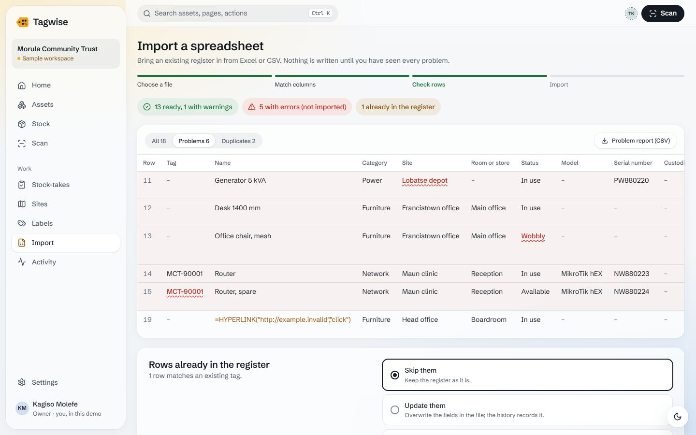 | 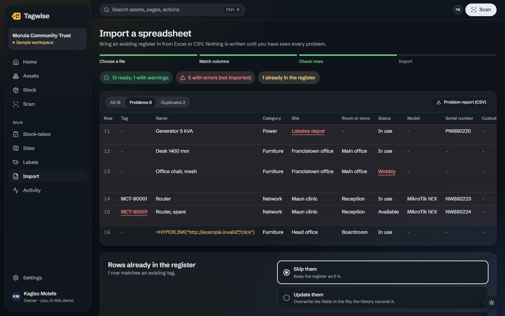 |
| 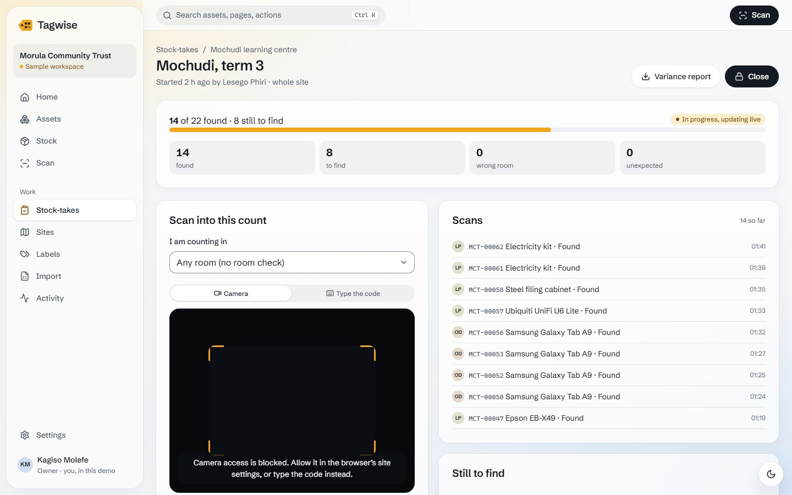 | 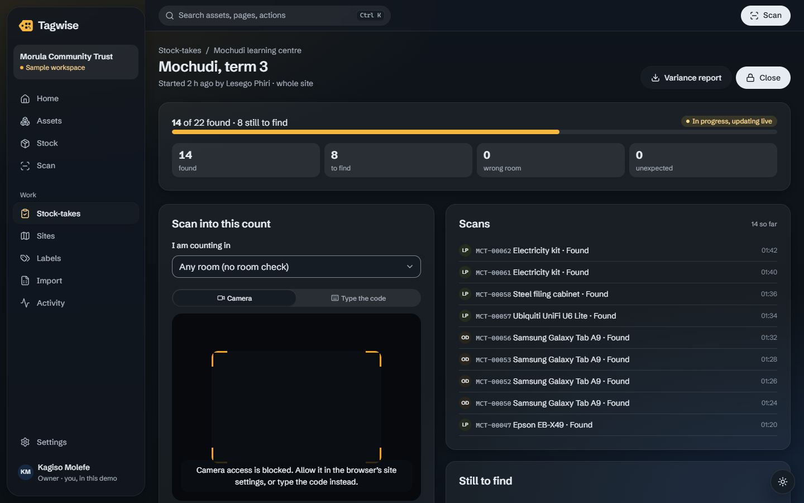 |
| 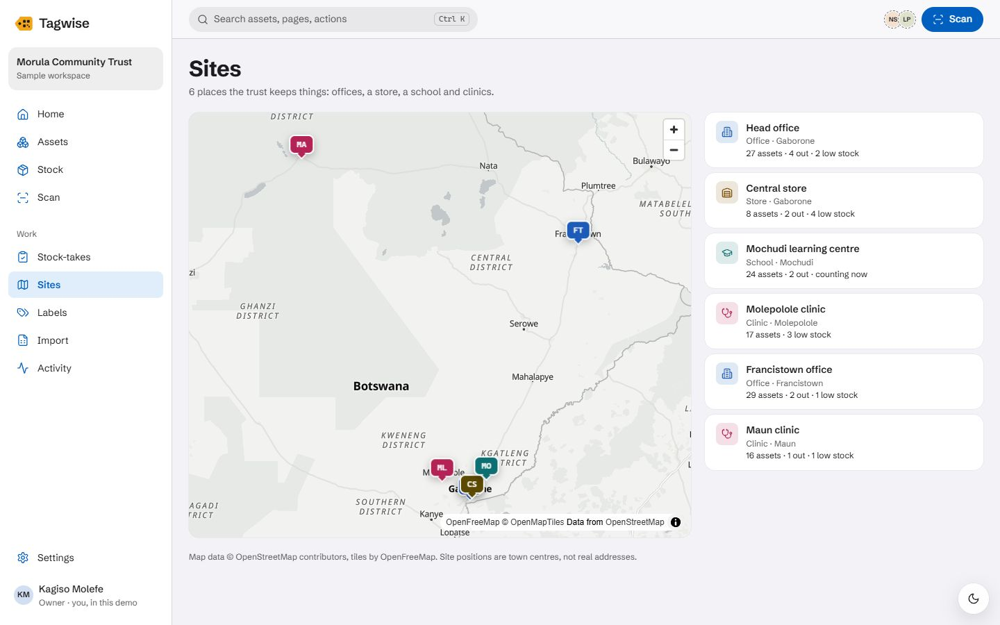 | 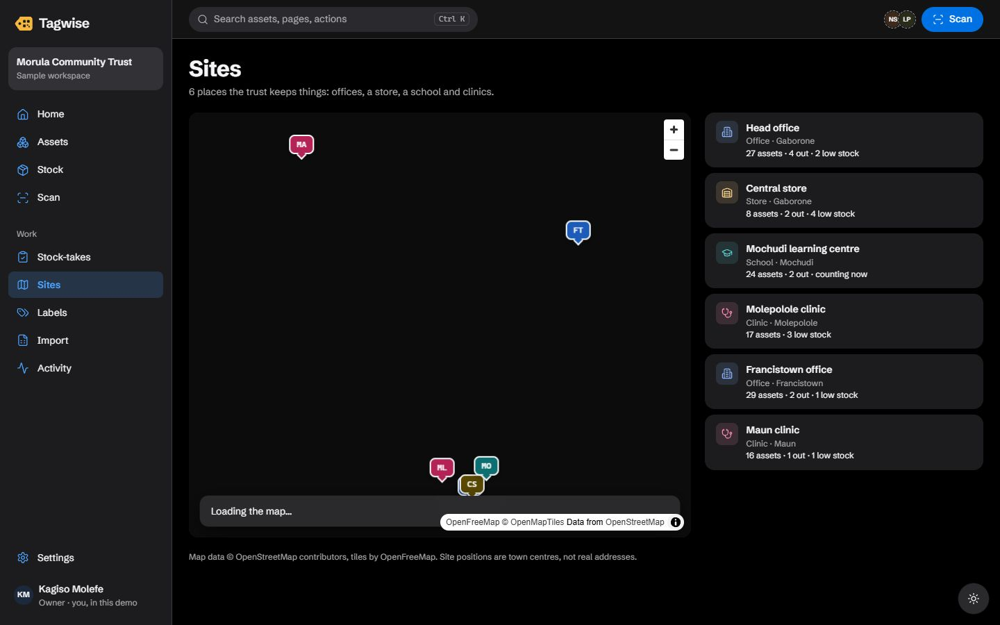 |

On a phone:

| Home | Register | Scan |
| --- | --- | --- |
| 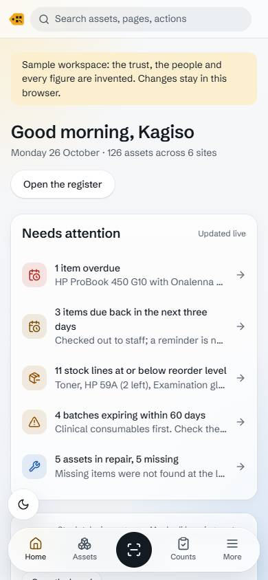 | 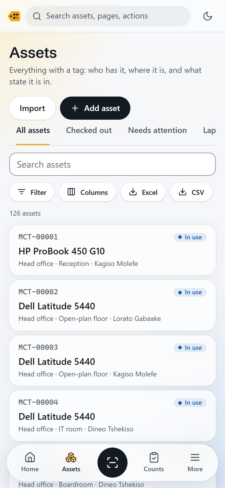 | 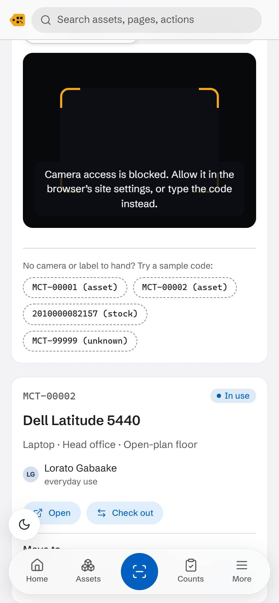 |

The screenshots are of the sample workspace: the trust, the people and every
figure are invented, and the app says so on screen.

## What is real, and what is demo

| Area | State |
| --- | --- |
| Register (assets and stock): saved views, filters, sort, columns, search, bulk selection | Works in the browser |
| Asset and stock pages: edit, check out and in, issue and receive, comments, history | Works in the browser |
| Shared editing | A stale edit is caught (version check) and you choose which version to keep. Shown working between two tabs |
| Live updates and presence | Real between tabs of the same browser (BroadcastChannel). Across devices it needs the server, which does not exist yet |
| Simulated teammates | Demo only: sample members shown as present (dashed ring) and an optional simulated counter in stock-takes. Labelled on screen and can be switched off |
| Scanning | Typed codes and handheld scanners work. Camera decoding (BarcodeDetector, with ZXing as the fallback) is built but **not yet tested on a real phone** |
| QR labels | A4 sheets of 18 and single labels render with working QR codes. **Not yet printed and scanned from paper** |
| Excel and CSV import | Works with the practice register: column matching, row checks, duplicates, problem report |
| Excel and CSV export | Built, with a formula guard. The files were not opened in a spreadsheet program during testing |
| Stock-takes | Works in the browser (tried with the simulated counter, typed scans, repeats and unknown codes). Updates between tabs use the same mechanism that was shown working for edits |
| Sites map | Works with an internet connection (OpenFreeMap tiles) |
| Roles | Owner, admin, editor, auditor, viewer. Enforced in the interface only: there is no server to enforce them yet |
| Sign-in, accounts, email | Not built. You pick a sample member to act as |
| Data storage | This browser's local storage only. Nothing is sent anywhere |

## Run it

Needs Node 20 or later (CI uses 22).

```sh
npm ci
npm run dev        # http://localhost:5280
```

| Command | What it does |
| --- | --- |
| `npm run dev` | Development server |
| `npm run build` | Type-check and build the static site into `dist/` |
| `npm run preview` | Serve `dist/` on port 5281 |
| `npm run lint` | ESLint |
| `npm run typecheck` | TypeScript |
| `npm test` | Unit tests (Vitest) |
| `npm run check:names` | Name gate: fails if another of the owner's product names appears in the code |
| `npm run screenshots` | Captures the screenshots above from a running dev server, using the Edge already installed |

## How it is built

- **React 18, TypeScript, Vite.** A static single-page app; any static host can serve `dist/`.
- **Data layer behind an interface** (`src/data/repository.ts`). Screens call only that interface. `LocalRepository` implements it on localStorage with a seeded sample workspace; an API-backed implementation can replace it without touching the screens.
- **Design tokens** in `src/theme/tokens.css`; components in `src/ui` and `src/app` read only those tokens. Light and dark are separate palettes; reduced motion and reduced transparency are honoured.
- **Route-level code splitting**, so the map, the spreadsheet library and the scanner fallback load only on the pages that need them.

## Deploy

Set up for Vercel. No environment variables are needed. See
[docs/DEPLOY.md](docs/DEPLOY.md).

## Dependencies

| Package | Why | Licence |
| --- | --- | --- |
| react, react-dom | Interface | MIT |
| lucide-react | Icons | ISC |
| qrcode | QR codes on labels | MIT |
| jsbarcode | EAN-13 and Code 128 barcodes | MIT |
| @zxing/library | Barcode decoding where the browser has no BarcodeDetector | Apache-2.0 |
| xlsx (SheetJS Community Edition 0.20.3, from cdn.sheetjs.com) | Reading and writing Excel files | Apache-2.0 |
| maplibre-gl | The sites map | BSD-3-Clause |
| @fontsource-variable/schibsted-grotesk | Display typeface, self-hosted | OFL-1.1 |

Development only: TypeScript, Vite, Vitest, ESLint and its plugins, jsdom,
playwright-core (screenshots). Map tiles come from
[OpenFreeMap](https://openfreemap.org) (free, no key), with data ©
OpenStreetMap contributors.

## Licence

Copyright (c) 2026 Mooketsi Vincent Magwaza. **All rights reserved.** There is
no licence file on purpose: no permission is granted to use, copy, modify or
distribute this code. Where the code came from is recorded in
[PROVENANCE.md](PROVENANCE.md).
